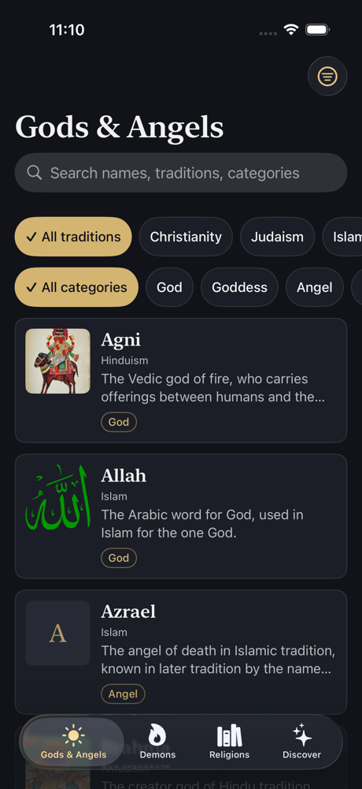
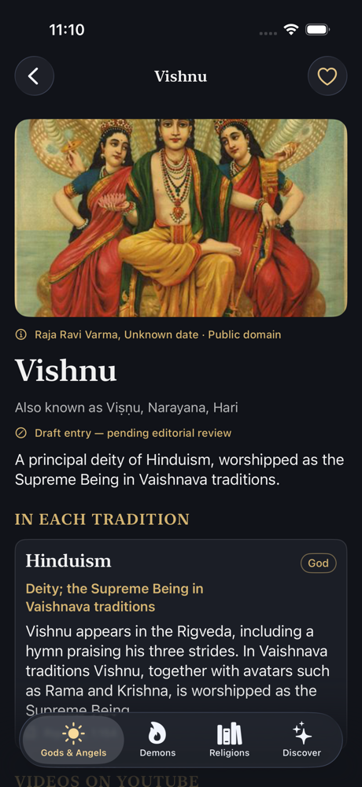
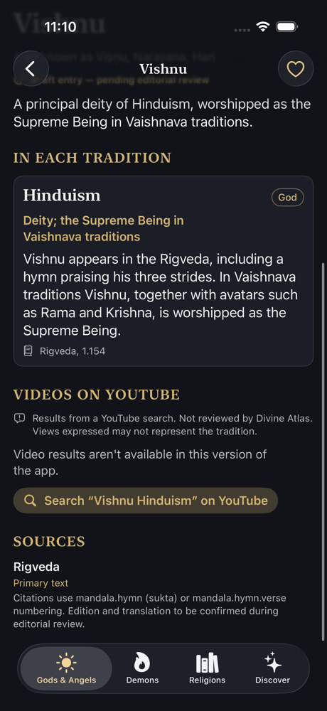
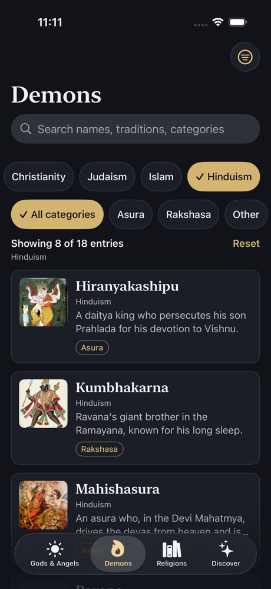
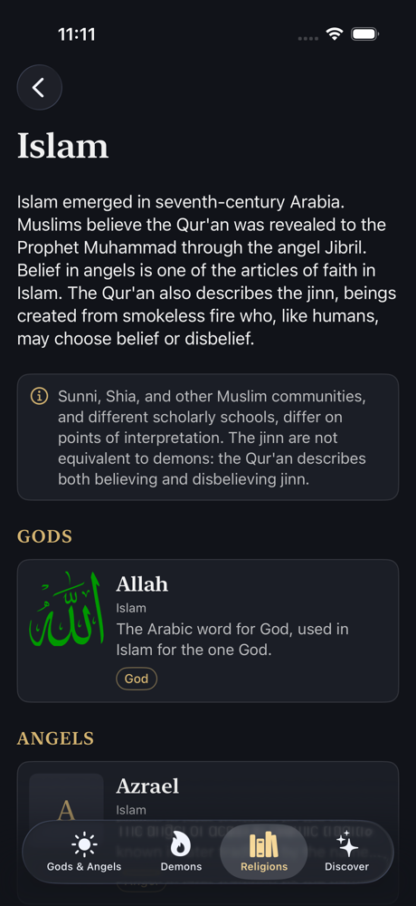
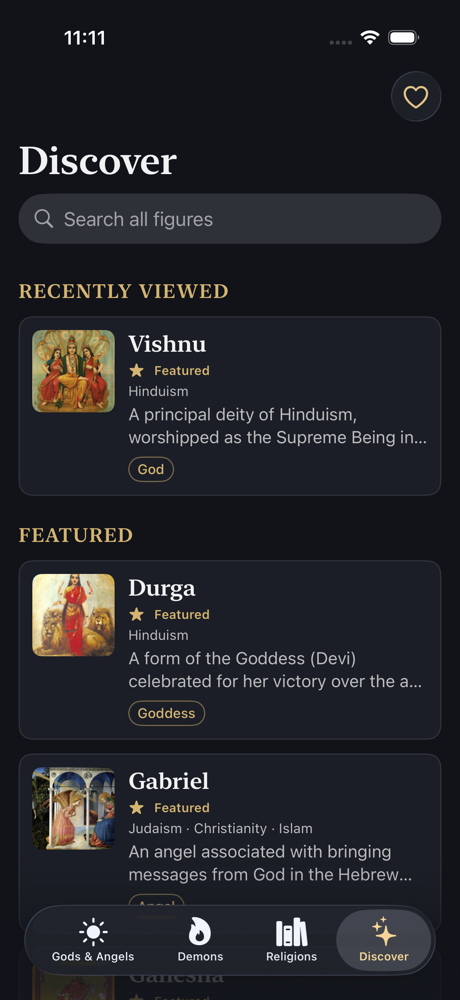

# Divine Atlas

A respectful, source-backed iOS encyclopedia of divine, angelic, demonic, and
other religious or supernatural figures across traditions. The MVP covers
Christianity, Judaism, Islam, and Hinduism: 67 figures, each described
**tradition by tradition** with citations to primary texts, licensed historical
artwork, and related YouTube videos.

Built with Swift 6 and SwiftUI (iOS 17+), with no third-party dependencies.

<p align="center">
  
  
  
</p>
<p align="center">
  
  
  
</p>

## Features

- **Four tabs:** Gods & Angels, Demons, Religions, and Discover. Each keeps
  its own navigation and filters.
- **Tradition-aware classification:** a figure is described separately for each
  tradition. Satan is an accuser in the heavenly court in Job, but the devil in
  Revelation. Jinn, asuras, and rakshasas are not automatically labelled
  "demons", so Mahabali and Vibhishana appear outside the Demons tab.
- **Sourced content:**
  - every claim cites a passage (e.g. Daniel 10:13, Qur'an 18:50, Rigveda 1.32)
  - entries are paraphrased, never quoted
  - draft entries are visibly marked until editorial review
- **Search and filters:**
  - matches transliterations and alternative names ("Jibril" finds Gabriel,
    "Visnu" finds Vishnu)
  - tradition and category filters, with sort options
  - global search from Discover
- **Licensed artwork:** 56 historical works from Wikimedia Commons (public
  domain, CC0, CC BY, CC BY-SA), each credited under the image. A
  religious-depiction policy applies; for example, there are no images of the
  Prophet Muhammad.
- **Videos on YouTube:** live, safe-searched results for each figure, clearly
  labelled as unreviewed, with a "Search on YouTube" fallback.
- **Favourites, recently viewed, and preferences:** saved on the device with
  SwiftData. Content works offline, and images are cached after first view.
- **Accessibility:** Dynamic Type up to the largest sizes, VoiceOver labels and
  actions, 44 pt touch targets, and no colour-only status.

## Status

Milestones 1–5b of the [product plan](requirements/Divine_Atlas_Claude_Code_Plan.md)
are complete. Release preparation (Milestone 6) is next. See
[ROADMAP](docs/ROADMAP.md). All content is a **draft pending editorial
review**.

## Requirements

| Tool | Version |
| --- | --- |
| Xcode | 26.1 or later (built and tested with 26.1) |
| Swift | 6 language mode, complete strict concurrency |
| iOS deployment target | **17.0**: the minimum for both SwiftData and the Observation framework (`@Observable`) |
| [XcodeGen](https://github.com/yonaskolb/XcodeGen) | 2.45+ (`brew install xcodegen`) |

No third-party runtime dependencies are used.

## Setup

The Xcode project is generated from `project.yml`. Do not edit
`DivineAtlas.xcodeproj` by hand; regenerate it after adding or removing files.

```sh
xcodegen generate
open DivineAtlas.xcodeproj
```

Optional: to enable the in-app YouTube video list, copy
`Config/Secrets.example.xcconfig` to `Config/Secrets.xcconfig` (gitignored)
and set `YOUTUBE_API_KEY`. Without it, entity pages show only the
"Search on YouTube" button.

Command-line build and test:

```sh
xcodebuild -project DivineAtlas.xcodeproj -scheme DivineAtlas \
  -destination 'platform=iOS Simulator,name=iPhone 17' test
```

The `DivineAtlas` scheme runs both unit tests (`DivineAtlasTests`) and UI tests
(`DivineAtlasUITests`). Run one suite with `-only-testing:DivineAtlasTests`
(about 10 seconds) or `-only-testing:DivineAtlasUITests` (several minutes).

Regenerate the README screenshots (requires network access for artwork):

```sh
TEST_RUNNER_DIVINE_ATLAS_SCREENSHOTS=1 xcodebuild -project DivineAtlas.xcodeproj -scheme DivineAtlas \
  -destination 'platform=iOS Simulator,name=iPhone 17' -resultBundlePath /tmp/shots.xcresult \
  test -only-testing:DivineAtlasUITests/ScreenshotUITests
xcrun xcresulttool export attachments --path /tmp/shots.xcresult --output-path /tmp/shots
```

## Project layout

```text
DivineAtlas/
├── App/            Entry point, composition root (DependencyContainer), tab shell
├── Core/           Design system, routing, shared utilities
├── Domain/         Models, repository protocols, use cases (pure logic)
├── Data/           Seed-data loader/validator, repository implementations
├── Features/       Browse (Gods & Angels / Demons), Religions, Discover, EntityDetail
└── Resources/      Asset catalog, SeedData/*.json
Tests/
├── DivineAtlasTests/    Unit tests (fixtures + mock repository)
└── DivineAtlasUITests/  UI tests for critical journeys
docs/               Architecture, data model, content and media rules, roadmap, JSON schemas
scripts/            Developer tooling (seed schema validation, content review, Commons media)
curation/           Image curation input (media.json), fetched Commons metadata, review sheet
```

## Documentation

- [Architecture](docs/ARCHITECTURE.md)
- [Data model](docs/DATA_MODEL.md)
- [Content guidelines](docs/CONTENT_GUIDELINES.md)
- [Media licensing](docs/MEDIA_LICENSING.md)
- [Roadmap & milestone status](docs/ROADMAP.md)
- [Content review checklist](docs/CONTENT_REVIEW.md)
- [Quality review](docs/QUALITY_REVIEW.md)

## Content status

The bundled dataset has **67 draft entries** across Christianity, Judaism,
Islam, and Hinduism, citing 23 primary and secondary sources. All entries show
a "pending editorial review" notice until a reviewer verifies them using
[`docs/CONTENT_REVIEW.md`](docs/CONTENT_REVIEW.md).

Artwork comes from Wikimedia Commons, and each image keeps its own licence and
credit (see [MEDIA_LICENSING](docs/MEDIA_LICENSING.md) and
`curation/MEDIA_REVIEW.md`). Screenshots in `docs/screenshots/` show those works
inside the app.

To check seed data edits against the JSON Schemas (optional, needs `jsonschema`):

```sh
python3 -m venv .venv && .venv/bin/pip install jsonschema
.venv/bin/python scripts/validate_seed_schema.py
```

The unit tests run the authoritative validator on every build.
